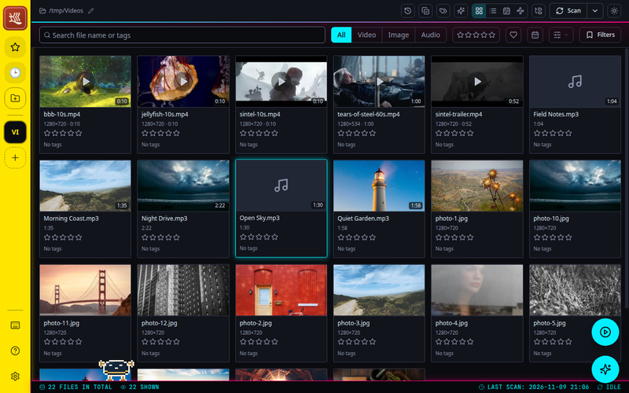
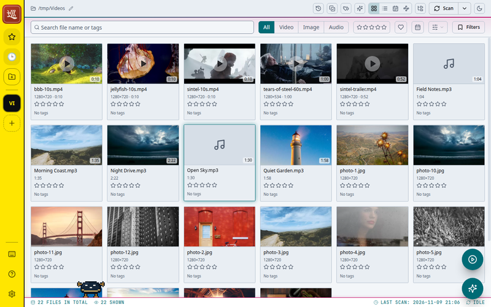
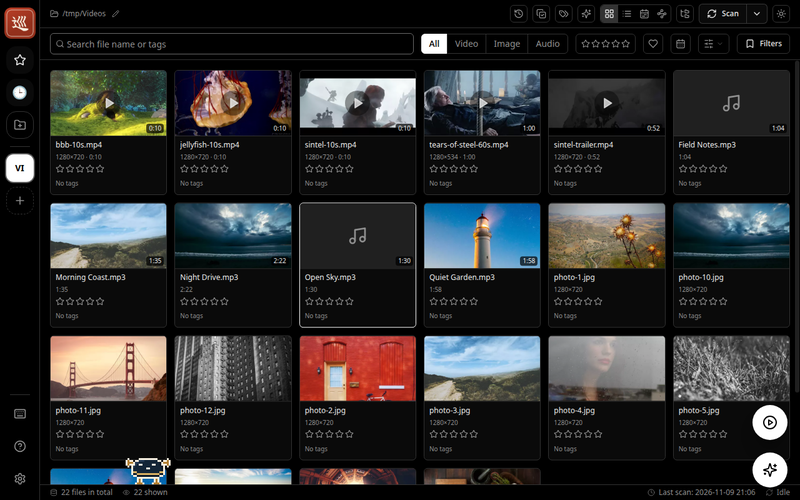
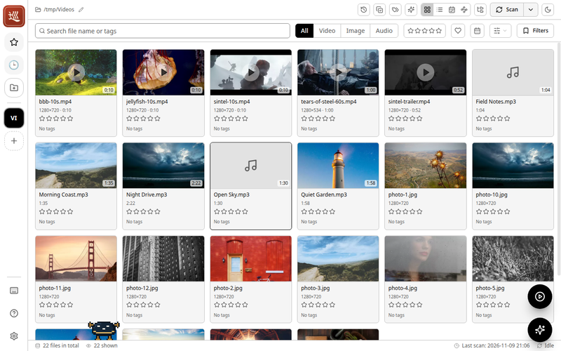
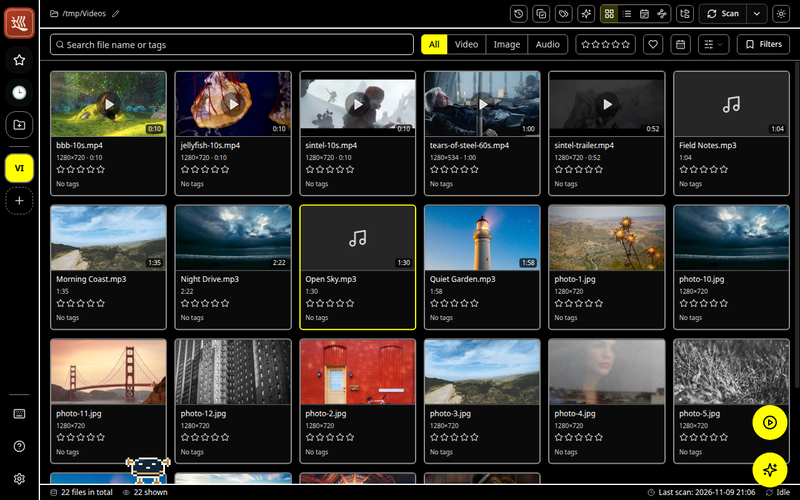
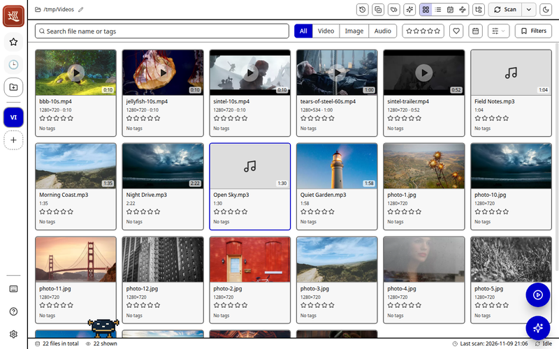
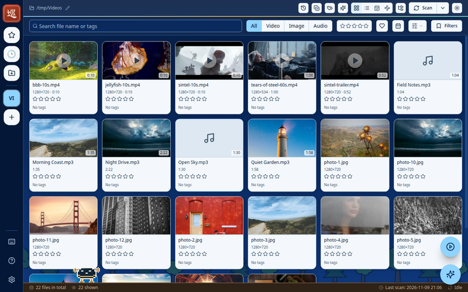
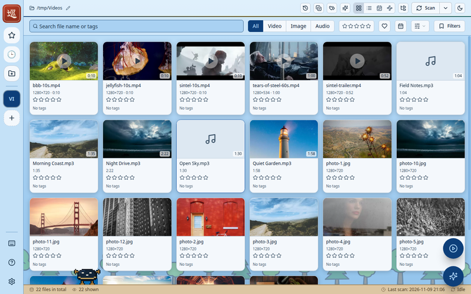

# Theming Meguri with CSS

Meguri can layer stylesheets over its built-in themes: a **CSS theme**
picked from a folder of theme files, and your own **`custom.css`** on top of
that. This page is the reference for writing either, whether for yourself or
to share.

The layers, from bottom to top:

1. The built-in theme last picked under **Settings → General → Theme**
2. The CSS theme picked in the same list, where theme files appear after the
   built-in themes. Picking a built-in theme again turns the CSS theme off
3. `custom.css`, when **Settings → General → Custom CSS** is on

At equal specificity a higher layer wins, so `custom.css` can adjust a CSS
theme.

`<userData>` below is, for example, `~/.config/meguri` on Linux.

## Installing a CSS theme

1. Open **Settings → General → CSS theme** and press **Open themes folder**.
   This opens `<userData>/themes/`.
2. Put the theme's `.css` file there (the extension in lower case). It appears
   in the **Theme** list right away.
3. Pick it. Saving the file applies the change right away.

The list shows the name from an `@name` line in the comment at the very top
of the file, or the file name if there is none:

```css
/*
 * @name Cyberpunk
 */
```

## Using custom.css

1. Open **Settings → General → Custom CSS** and turn the switch on.
2. Press **Open file**. Meguri creates `<userData>/custom.css` from a commented
   template (an existing file is never overwritten) and opens it in your
   default app.
3. Save the file. Every save applies right away.

## Trust and recovery

A stylesheet can change or hide anything shown in the window, including the
labels of buttons. Read a shared theme before applying it, and use themes
from sources you trust.

If a stylesheet makes the window unusable, move the theme file out of
`<userData>/themes/`, or delete or rename `custom.css`, and the app returns
to normal.

## Public API

A stylesheet can rely on the following. Anything else — Tailwind class names,
the DOM structure, attributes of the UI library — may change in any release
without notice.

- The `--c-*` color variables
- The `data-slot` values listed below
- `data-appearance` on `<html>`
- `aria-current="true"` on the focused item of the grid and the list

A change to any of these is called out in the release notes.

## Color variables

Every color in the UI comes from these variables. Override them to recolor
the whole app.

| Variable               | Used for                                     |
| ---------------------- | -------------------------------------------- |
| `--c-bg`               | Window background                            |
| `--c-surface`          | Raised panels, cards, menus                  |
| `--c-overlay`          | Raised fills: placeholders, chips, row hover |
| `--c-hover`            | Highlighted item in menus and lists          |
| `--c-border`           | Hairline separators                          |
| `--c-border-strong`    | Form control outlines, meaningful borders    |
| `--c-muted`            | Secondary text and idle icons                |
| `--c-secondary-fg`     | Tertiary text                                |
| `--c-fg`               | Body text                                    |
| `--c-bright-fg`        | Headings and the strongest text              |
| `--c-highlight`        | Highlights                                   |
| `--c-primary`          | Main accent: buttons, switches, focus rings  |
| `--c-accent2`          | Second accent                                |
| `--c-secondary-accent` | Third accent                                 |
| `--c-info`             | Informational accents                        |
| `--c-success`          | Success                                      |
| `--c-warn`             | Warnings                                     |
| `--c-error`            | Errors and destructive actions               |
| `--c-special`          | Rarely used accent                           |

Text drawn on a `--c-primary` fill uses `--c-bg`, so keep the two readable
against each other.

## Choosing what to override

The built-in themes declare the variables on `html[data-theme="<id>"]`.
`custom.css` is applied after them, so a selector of the same specificity
wins. A plain `:root` rule is weaker and loses.

```css
/* Every theme */
html[data-theme] {
  --c-primary: #e06c75;
}

/* Dark themes only, light themes only */
html[data-appearance="dark"] {
  --c-bg: #101014;
}
html[data-appearance="light"] {
  --c-bg: #fbfaf7;
}

/* One built-in theme only (ids look like "gruvbox-dark", "nord-light") */
html[data-theme="gruvbox-dark"] {
  --c-bg: #1d2021;
}
```

A theme meant for sharing should set both `data-appearance` variants, so the
light / dark switch in Settings keeps working. Overriding `html[data-theme]`
alone makes every theme look the same in both modes.

## Parts of the UI

These parts carry a `data-slot` attribute.

| `data-slot`        | Part                                            |
| ------------------ | ----------------------------------------------- |
| `workspace-rail`   | Side rail                                       |
| `home-header`      | Workspace info header                           |
| `filter-bar`       | Search and filters                              |
| `status-bar`       | Footer                                          |
| `audio-player-bar` | Audio player at the bottom                      |
| `media-card`       | A file in the grid                              |
| `media-row`        | A file in the list                              |
| `folder-card`      | A folder in the grid                            |
| `folder-row`       | A folder in the list                            |
| `modal-panel`      | Full-size windows (settings, file details, ...) |

The focused item in the grid or the list has `aria-current="true"`.

```css
[data-slot="media-card"] {
  border-radius: 14px;
}
[data-slot="media-card"][aria-current="true"] {
  outline: 2px solid var(--c-info);
  outline-offset: 2px;
}
```

Variables cascade, so redefining them on a part recolors everything inside
it — icons, hover states and the active item included:

```css
[data-slot="workspace-rail"] {
  --c-bg: #fcee0a;
  --c-surface: #e8da00;
  --c-fg: #0a0a14;
  --c-muted: #4d4800;
  background-color: var(--c-bg);
}
```

Leave the properties that show selection alone, or the selection can become
invisible:

- Every item draws its selected and focused rings with `box-shadow`.
- `media-card` also shows selection with its border color.
- `media-row` and `folder-row` also show selection with their background.

Radius, spacing, `outline` and `filter` are free to change.

## Contrast

The built-in themes are corrected for contrast before they are applied. A
stylesheet is applied as written, so check it yourself. The built-in themes
aim for these minimum contrast ratios:

| Pair                                                      | Minimum     |
| --------------------------------------------------------- | ----------- |
| `--c-fg` against `--c-bg` and `--c-surface`               | 4.5         |
| `--c-bright-fg` against `--c-bg`                          | 4.5         |
| `--c-muted` against `--c-bg` / `--c-surface`              | 4.5 / 4     |
| `--c-fg` on `--c-overlay`, `--c-bright-fg` on `--c-hover` | 4.5         |
| `--c-primary`, `--c-error`, `--c-info` against `--c-bg`   | 4.5         |
| `--c-accent2` against `--c-bg` (used for icons)           | 3           |
| `--c-border-strong` against `--c-bg` and `--c-surface`    | 3           |
| `--c-border` against `--c-bg` and `--c-surface`           | 1.5         |
| `--c-overlay` against `--c-bg` / `--c-surface`            | 1.25 / 1.15 |
| `--c-hover` against `--c-surface`                         | 1.35        |

The other accents are not corrected; keep any you use as text at 4.5 or
more.

## Fonts and images

Meguri makes no network requests apart from the optional update check. Its
Content Security Policy blocks `@import` and `url()` pointing at other hosts;
images from the local machine (`127.0.0.1`) are allowed, because the app
serves its own media from there. A stylesheet can use:

- Fonts installed on the system, by name
- Fonts and images embedded as `data:` URIs

```css
@font-face {
  font-family: "My Font";
  src: url("data:font/woff2;base64,...") format("woff2");
}
html[data-theme] body {
  font-family: "My Font", sans-serif;
}
```

## Sample themes

| File                                                 | Look                  |
| ---------------------------------------------------- | --------------------- |
| [themes/cyberpunk.css](themes/cyberpunk.css)         | Neon on black         |
| [themes/oled.css](themes/oled.css)                   | True black            |
| [themes/matrix.css](themes/matrix.css)               | Green terminal rain   |
| [themes/sky.css](themes/sky.css)                     | Sky, clouds and trees |
| [themes/high-contrast.css](themes/high-contrast.css) | 7:1 text, bold lines  |

Each has a dark and a light variant and meets the contrast minimums above:

| Theme         | Dark                                                            | Light                                                             |
| ------------- | --------------------------------------------------------------- | ----------------------------------------------------------------- |
| Cyberpunk     |          |          |
| OLED          |                    |                    |
| High Contrast |  |  |
| Sky           |                      |                      |

They keep to the public API, except for a few rules in Cyberpunk and Sky
whose comments say so. Install one as a CSS theme to try it, or copy it as a
starting point.

## Sharing a theme

A theme is a single `.css` file, named by its `@name` line. Share it any way
you like, for example as a gist or in a repository. Meguri does not download
themes by itself.
